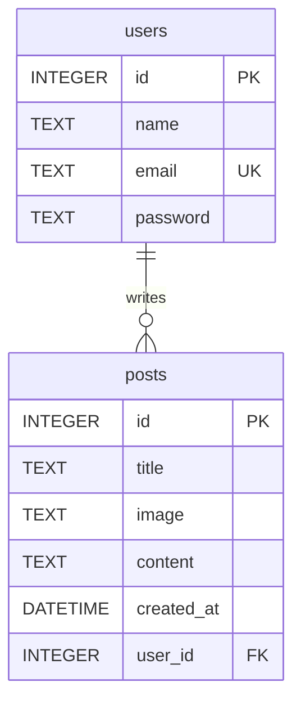

# Physical data model

`posts.user_id` references `users.id`, so each post belongs to one user and a
user can have zero or more posts. `users.email` is unique. Password values
must be password hashes, never plain-text passwords. The matching DDL lives in
[`src/database/schema.sql`](../src/database/schema.sql).
